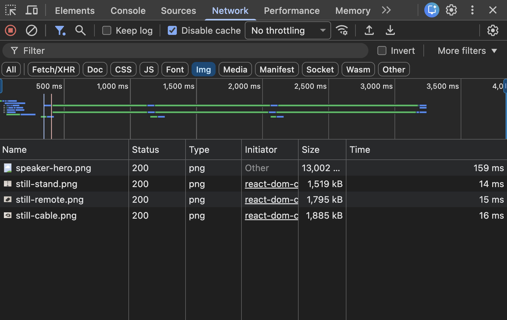
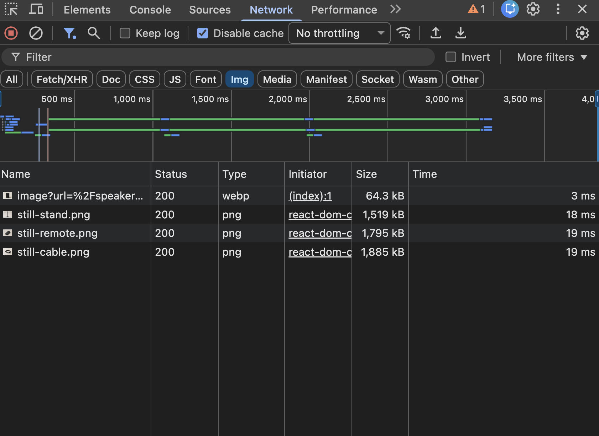

# Image Optimization

This experiment replaces the product images with `next/image`. The goal is to reduce unnecessary image transfer while assigning different loading priorities to images above and below the first viewport.

## Hero Image Result

| Metric | Before | After |
| --- | ---: | ---: |
| Request | `/speaker-hero.png` | `/_next/image?...` |
| Format | PNG | WebP |
| Transferred size | 13,002 kB | 64.3 kB |
| Status | 200 | 200 |

The browser received approximately 99.5% fewer bytes for the hero image. This is about a 200× reduction in transferred size.

The request times shown in the screenshots are not treated as performance results. They were measured on localhost with no network throttling and can also be affected by the image optimizer cache.

### Before



### After



## Hero Image Change

The native image element:

```tsx

```

was replaced with:

```tsx
<Image
  src="/speaker-hero.png"
  alt="Still One wireless speaker"
  width={2400}
  height={1800}
  sizes="(max-width: 800px) 100vw, 61vw"
  loading="eager"
/>
```

The original PNG remains unchanged. `next/image` creates and serves an optimized derivative when the browser requests the image.

## What `next/image` Does

### Provides responsive image candidates

`next/image` generates a `srcset` containing multiple image widths. The browser chooses a candidate using:

- the current viewport width;
- the device pixel ratio;
- the rendered image width described by `sizes`.

This avoids sending the same 2400 px source image to every device.

### Resizes the source image

The optimized request includes the selected width. For example:

```text
/_next/image?url=%2Fspeaker-hero.png&w=1200&q=75
```

In this request, `w=1200` is the generated image width and `q=75` is the requested quality.

### Negotiates a more efficient format

The original asset is a PNG, but the measured response was WebP because the browser advertised WebP support. Format selection depends on browser support and the Next.js image configuration.

### Preserves layout stability

The declared `width` and `height` describe the source image's intrinsic 4:3 ratio. The browser can reserve space before the image finishes loading, reducing the risk of layout shift.

These values describe the source dimensions. CSS still controls the rendered size and crop.

### Starts the LCP candidate without lazy-loading deferral

The hero is visible in the initial viewport and was detected as the Largest Contentful Paint candidate. `loading="eager"` tells the browser to request it immediately when the image element is discovered instead of applying the default lazy-loading behavior.

Next.js also provides `preload`, which inserts a preload link into the document head. That is a stronger hint and can start the request before the image element is discovered, but it can waste bandwidth when the image is not consistently the LCP candidate. This experiment uses eager loading first and leaves preload as a measurement-driven alternative.

### Caches generated variants

Next.js can reuse an optimized variant after it has been generated. Cache behavior and the cost of the first transformation depend on the runtime and deployment environment.

## Why `sizes` Matters

The layout changes at 800 px:

- At 800 px and below, the image occupies the full viewport width: `100vw`.
- Above 800 px, the image column occupies approximately 61% of the viewport: `61vw`.

```tsx
sizes="(max-width: 800px) 100vw, 61vw"
```

Without an accurate `sizes` value, the browser may select an image that is larger than the layout needs. Using `next/image` alone does not guarantee an efficient response; the component must describe the real layout.

## Hero Image Verification

The dedicated image test passes all three acceptance checks:

```bash
corepack pnpm test:image
```

- The optimized hero image is delivered successfully within the 500 kB lab budget.
- The hero image declares stable intrinsic dimensions.
- The above-the-fold LCP candidate uses eager loading.

## Related Product Images

The three related product cards originally requested their full 1.5–1.9 MB PNG sources even though each image occupies only one third of the desktop content area.

They use the same image optimization pipeline with a different loading strategy:

```tsx
<Image
  src={item.image}
  alt={item.name}
  width={1448}
  height={1086}
  sizes="(max-width: 800px) 86vw, calc((86vw - 40px) / 3)"
  loading="lazy"
/>
```

The source dimensions preserve the 4:3 aspect ratio. The `sizes` value describes the responsive layout:

- On screens up to 800 px, one card occupies approximately 86% of the viewport width.
- On wider screens, three cards share that width with two 20 px gaps.

Unlike the hero, these images are below the first viewport. Lazy loading prevents them from competing with the LCP image and other critical resources. Their requests begin when the browser determines that they are close enough to the viewport.

```bash
corepack pnpm test:related-images
```

The dedicated test verifies that all three images declare lazy loading, provide responsive candidates, pass through the Next.js image optimizer, and stay within the 300 kB per-image lab budget. The budget is a regression guard for this page, not a universal recommendation.

## What This Experiment Does Not Prove

This experiment verifies response sizes, responsive candidates, intrinsic dimensions, and loading behavior. It does not by itself prove that the final LCP or CLS values improved. Those metrics still depend on server response time, resource discovery, transfer time, decoding, rendering, and the rest of the page, so they must be measured in a production trace.

The original 13 MB PNG also remains part of the repository and deployment input. `next/image` reduces browser transfer, but it does not reduce the source asset or repository size.

## Reference

- [Next.js Image component](https://nextjs.org/docs/app/api-reference/components/image)
