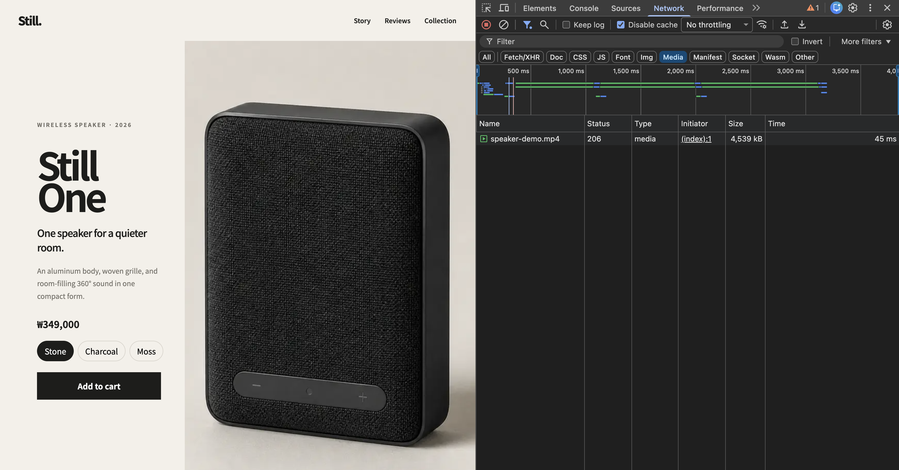
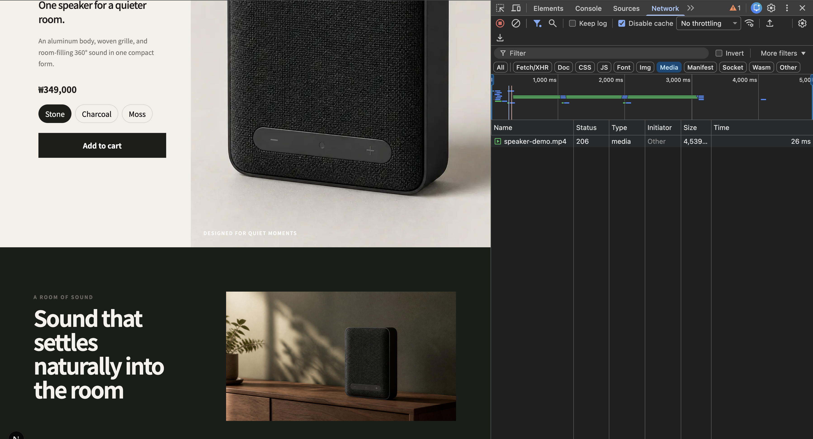

# Offscreen Autoplay Video Loading

This experiment defers the product video until its section enters the viewport. The goal is to remove a 4.5 MB autoplay video from the initial page load without leaving an empty space while the video starts.

## Result

| Stage | Video request | Transferred video size |
| --- | --- | ---: |
| Before: initial page load | Requested immediately | 4,539 kB |
| After: initial page load | Not requested | 0 kB |
| After: story enters the viewport | Requested | 4,539 kB |

This change does not reduce the video file itself. It moves the request from the initial page load to the point where the user reaches the video.

The screenshots were captured on desktop localhost with the browser cache disabled and no network throttling. Request duration is therefore not treated as a performance result. A `206 Partial Content` response is expected for a browser media range request.

### Before



### After



## Problem

The original video was rendered with `autoPlay` and `preload="auto"`:

```tsx
<video autoPlay loop muted playsInline preload="auto">
  <source src="/speaker-demo.mp4" type="video/mp4" />
</video>
```

An autoplay video needs data before it can play, so the browser can start downloading it even when the element is outside the initial viewport. `preload` alone is not a reliable guard because it is a browser hint and autoplay takes precedence.

## Change

The page now uses a small `Video` component:

```tsx
<Video
  src="/speaker-demo.mp4"
  poster="/speaker-demo-poster.jpg"
  width={1920}
  height={1080}
  loading="lazy"
  autoPlay
  loop
  muted
  playsInline
  preload="auto"
/>
```

When `loading="lazy"` is used, the component renders no video `src` until an Intersection Observer reports that the element has entered the viewport. Once the source is attached, the existing autoplay behavior starts the download and playback.

```text
Outside the viewport
→ no video src
→ no video request

Inside the viewport
→ attach video src
→ download and autoplay
```

The missing `src`, rather than `preload="none"`, is what guarantees that the browser cannot request the video early.

## Why Intersection Observer

Intersection Observer connects loading to whether the user has reached the video. It is useful here because all of the following are true:

- the video begins outside the initial viewport;
- the video autoplays;
- the source is large enough to compete with initial page resources;
- playback is not required before the user sees the story section.

This is not a rule for every video. A user-initiated video using `preload="none"`, an above-the-fold video, or a project that relies on native video lazy loading may not need a custom observer.

## Poster and Layout Stability

The 68 kB poster is requested during the initial page load and remains visible until the first video frame is ready. This is an intentional trade-off: a small image is loaded early so the user does not see an empty video area on a slower connection.

The poster does not prevent layout shift by itself. The required `width` and `height` values declare the video's 16:9 ratio, and the component applies the same ratio before media metadata is available. The rendered width and height remain stable when playback begins.

## Trade-offs

- The video starts loading only after it becomes visible, so the poster may remain visible longer on a slow network.
- The behavior depends on JavaScript and React hydration. If JavaScript does not run, the poster remains but the video source is never attached.
- The observer disconnects after the first intersection. Scrolling past the video still starts the request, and leaving the viewport does not cancel the download or pause playback.
- The poster is eager and adds a 68 kB image request to the initial page load.
- The 4.5 MB MP4 is unchanged. Encoding, multiple formats, adaptive streaming, and external video hosting are outside this experiment.

These trade-offs are acceptable for this lab because the video is a decorative, offscreen product demonstration and the experiment is intentionally limited to initial request timing.

## Verification

The dedicated video test is part of the baseline requirements:

```bash
corepack pnpm test:video
```

It verifies that:

- the story begins outside the initial viewport;
- the video has stable 1920 × 1080 intrinsic dimensions;
- the poster is present;
- the video reserves a 16:9 layout before loading;
- no video request occurs above the fold;
- the request begins and succeeds after the story enters the viewport.

## References

- [web.dev: Video performance](https://web.dev/learn/performance/video-performance)
- [MDN: The video element](https://developer.mozilla.org/en-US/docs/Web/HTML/Reference/Elements/video)
