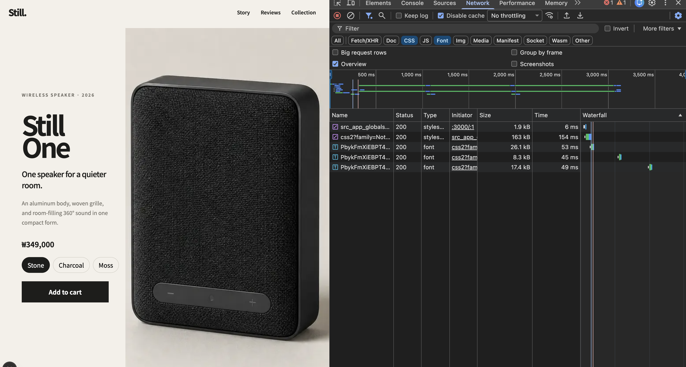
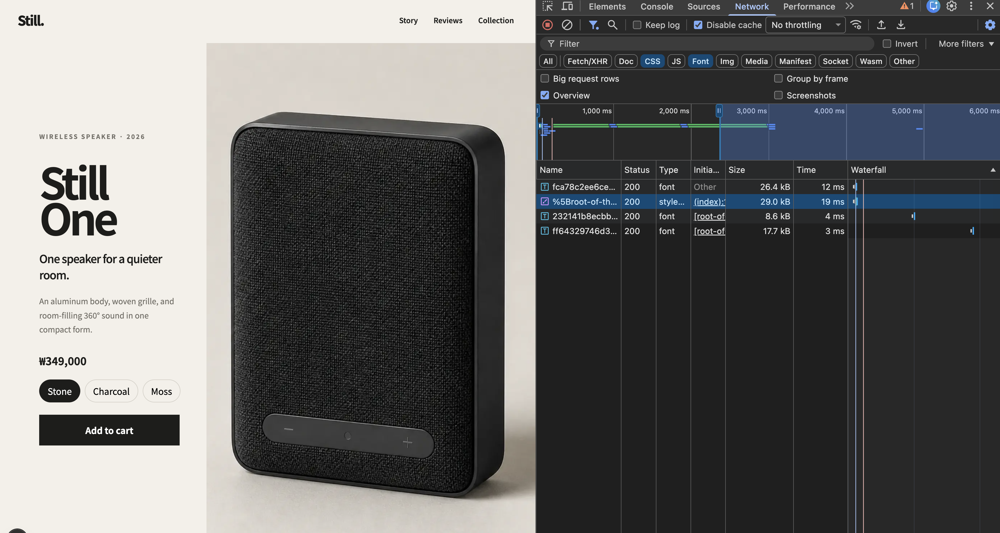

# Font Loading Optimization

This experiment replaces a Google Fonts CSS `@import` with `next/font`. The goal is to remove the external stylesheet dependency from the critical rendering path and let the browser discover the first required font earlier.

## Result

| Observation | Before | After |
| --- | --- | --- |
| Font stylesheet | Google Fonts CSS, 163 kB | No external font stylesheet |
| Font origin | `fonts.gstatic.com` | Same-origin `/_next/static/media/...` |
| First font discovery | After two stylesheets | Preloaded from the initial document |
| Font files visible in the final capture | 3 | 3 |

The important improvement is the dependency chain, not the number of font files.

```text
Before
HTML
└─ application CSS
   └─ Google Fonts CSS
      └─ font files

After
HTML
├─ preloaded first font
└─ application CSS
   └─ additional font subsets when needed
```

In the filtered development-server captures, the visible CSS and font responses total approximately 216.7 kB before and 81.7 kB after. This is useful evidence of the removed 163 kB Google Fonts stylesheet, but it is not a production benchmark: generated development CSS and request timing can vary between runs.

### Before



### After



## Problem

The original stylesheet imported Google Fonts at runtime:

```css
@import url("https://fonts.googleapis.com/css2?family=Noto+Sans+KR:wght@300;400;500;600;700;800;900&display=swap");
```

The browser's preload scanner can discover the application stylesheet while scanning the HTML. It cannot see the nested font stylesheet until the application CSS has downloaded and been parsed. The font URLs are discovered only after the Google Fonts CSS has also downloaded and been parsed.

Each step depends on the previous step, creating a request waterfall. The external origins can also require additional DNS, connection, and TLS setup.

## Change

The font is now declared in the root layout:

```tsx
import { Noto_Sans_KR } from "next/font/google";

const notoSansKr = Noto_Sans_KR({
  display: "swap",
  subsets: ["latin"],
  weight: "variable",
});

export default function RootLayout({ children }: LayoutProps<"/">) {
  return (
    <html lang="en">
      <body className={notoSansKr.className}>{children}</body>
    </html>
  );
}
```

The CSS `@import` and manual `font-family` declaration were removed. Applying the generated class to `body` makes the font inherit across the page without importing it in individual components.

## What `next/font` Does

### Downloads the font during the build

For `next/font/google`, Next.js fetches the selected Google font while building the application. A production browser does not contact Google Fonts to render the page.

This differs from `next/image`: font assets are known while the application is built, so they can be prepared ahead of user requests.

### Self-hosts the generated font assets

Next.js emits the font files as hashed application assets and serves them from the same origin as the page. This removes the runtime dependency on `fonts.googleapis.com` and `fonts.gstatic.com`.

### Generates the font CSS and class name

The returned `className` points to generated `@font-face` rules and the appropriate `font-family`. The application does not need to maintain these rules manually.

### Preloads the selected subset

Because the font is used in the root layout, Next.js can add a preload hint to the document for the selected subset. The preload scanner can therefore discover the first font directly from HTML and request it in parallel with the application CSS.

`subsets: ["latin"]` controls which subset is preloaded. It does not mean that Korean glyphs are removed from the font configuration. Additional unicode-range files can still be requested if the rendered content needs them.

### Uses a variable font

`weight: "variable"` allows one font variation to cover the weights used by the design instead of configuring a separate static file for every weight. The three font responses in the After screenshot should not be interpreted as three weight files; they are font subsets selected through generated unicode ranges.

### Reduces layout-shift risk

`display: "swap"` shows fallback text instead of hiding text while the web font loads. `next/font` also generates fallback metrics intended to make the fallback font occupy space closer to the final font, reducing the risk of a visible layout shift when the font swaps.

This reduces risk but does not prove that CLS is zero. CLS still needs to be measured separately.

## Trade-offs

- The font is downloaded during the build, so a build requires access to the Google Fonts source.
- A large character set may still be split into multiple files and loaded as matching characters appear.
- Preloading is useful only for fonts needed early. Preloading too many fonts can compete with other critical resources.
- `display: "swap"` keeps text visible, but users may briefly see the fallback font.
- Development-server sizes and timing are not substitutes for a production Lighthouse or performance trace.

## Verification

The dedicated font test is part of the baseline requirements:

```bash
corepack pnpm test:font
```

It verifies that the page does not load an external stylesheet on the critical path. The Network panel additionally confirms the behavior that the test does not cover directly:

- there is no request to Google Fonts;
- font files are served from the application origin;
- the first font is preloaded from the initial document;
- later unicode subsets are requested only when needed.

## References

- [Next.js Font Optimization](https://nextjs.org/docs/app/getting-started/fonts)
- [Next.js `next/font` API](https://nextjs.org/docs/app/api-reference/components/font)
