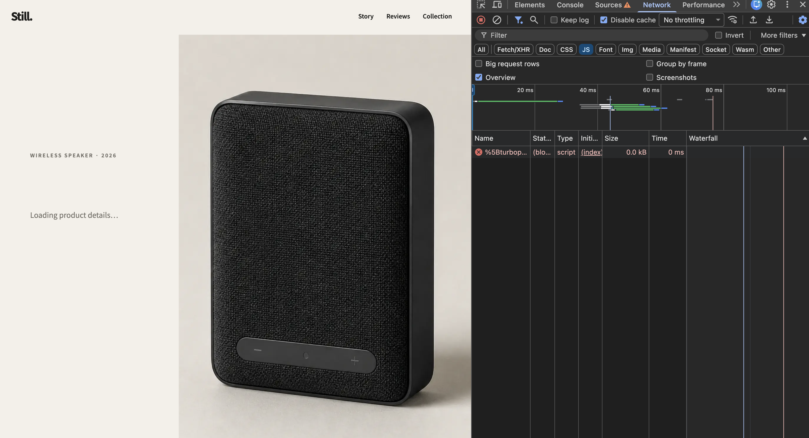
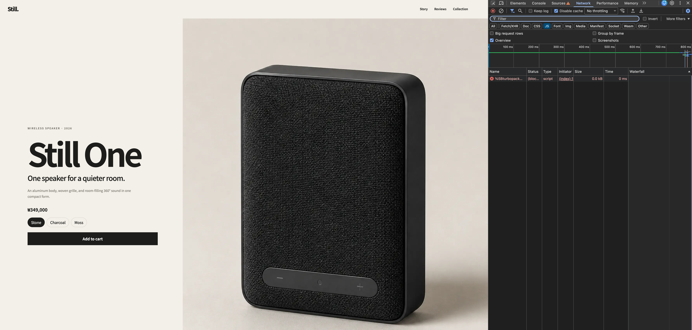

# Server-rendered Product Content

This experiment moves the primary product read from the browser to a Server Component. The goal is to include useful product content in the initial HTML instead of waiting for JavaScript, hydration, and a client-side API request.

## Result

| JavaScript disabled | Before | After |
| --- | --- | --- |
| Product name, description, and price | Not available | Visible |
| Product placeholder | Visible indefinitely | Removed |
| Browser request to `/api/product` | Required | Removed |
| Purchase interactions | Unavailable | Unavailable until JavaScript runs |

### Before



### After



The controls are present in the server-rendered HTML, but selecting a color and adding to the cart still require JavaScript for event handlers and state.

## Rendering Flow

Before, the browser had to complete a client-side waterfall:

```text
HTML
→ JavaScript
→ hydration
→ /api/product
→ product render
```

After, the server reads the product before rendering the response:

```text
request
→ server reads product
→ HTML already contains product content
→ hydration enables purchase interactions
```

This removes the browser's product API round trip and makes the primary content independent of client-side JavaScript execution.

## Server and Client Boundaries

The page is separated by responsibility rather than placing the whole storefront inside one Client Component:

```text
Home                    Server Component
├─ ProductDetails       Server Component
│  └─ ProductPurchase   Client Component
├─ ProductStory         Server Component
│  └─ Video             Client Component
└─ ProductContent       Client Component
   ├─ ProductReviews
   └─ RelatedProducts
```

`ProductDetails` renders the product copy and image on the server. `ProductPurchase` contains only the color and cart state that requires browser interactivity. Server Components can render Client Components directly; a `children` slot is not required for this direction of composition.

Only the product colors cross the Server-to-Client boundary because the browser needs them for selection state. Static product rendering code is not included in the client bundle.

## Request-time Rendering

The page calls `connection()` before reading the product:

```tsx
export default async function Home() {
  await connection();
  const product = await getProduct();

  return <ProductDetails product={product} />;
}
```

This lab intentionally renders the page for each request instead of allowing Next.js to prerender the fixed sample product during the build. The production build identifies `/` as a dynamic route.

## Trade-off

The simulated product read takes 700 ms. Client-side rendering could return an empty shell sooner, while the current server-rendered page waits for the product before sending the completed response. TTFB may therefore increase even though the client-side waterfall is removed.

Server rendering does not make the data source faster. It changes where the wait happens and ensures that the HTML is useful when it arrives.

## Why Suspense Is Separate

A Suspense boundary could stream the page shell while the server waits for the product. That would combine two different experiments:

- this experiment: move primary content from client rendering to server rendering;
- a later experiment: stream independent sections progressively.

Keeping them separate makes the effect of each change observable. Reviews and related products are better initial streaming candidates because they are delayed, below the first viewport, and not required to understand the primary product.

## Verification

```bash
corepack pnpm test:rendering
```

The test disables JavaScript and verifies that the primary product tagline is visible. The image and video regression tests also pass after the component boundary changes.

## References

- [Next.js Server and Client Components](https://nextjs.org/docs/app/getting-started/server-and-client-components)
- [Next.js `connection()`](https://nextjs.org/docs/app/api-reference/functions/connection)
