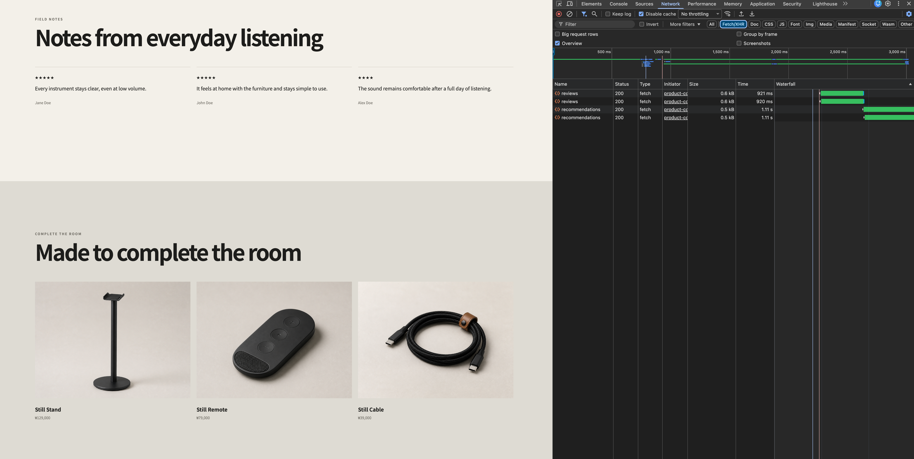
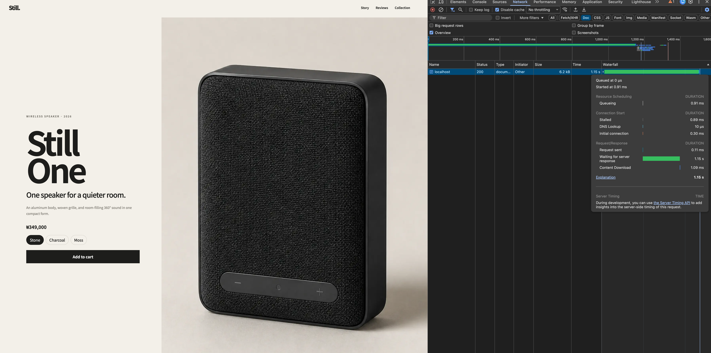

# Parallel Server Data

This experiment replaces the client-side request waterfall with parallel server-side reads. The goal is to reduce the total data wait before introducing streaming.

## Result

| Stage | Request behavior | Observed result |
| --- | --- | --- |
| Baseline | The browser requests reviews, then recommendations | The delays are added together |
| Client `Promise.all` trial | The browser requests both endpoints after hydration | About 2.1 seconds; the 1.8-second data test still failed |
| Server `Promise.all` | The server starts product, review, and recommendation reads together | About 1.4 seconds; the data test passed |

The client trial removed the API-to-API waterfall, but it still started only after the 700 ms product render and hydration. Moving the independent reads to the server allowed all three waits to overlap.

## Before: Sequential Browser Requests



The baseline client component waited for reviews before requesting recommendations:

```tsx
const reviewResponse = await fetch("/api/reviews");
const reviews = await reviewResponse.json();

const recommendationResponse = await fetch("/api/recommendations");
const recommendations = await recommendationResponse.json();
```

The 900 ms and 1,100 ms simulated delays therefore formed a waterfall. The development screenshot contains duplicate requests because React Strict Mode re-runs Effects in development; the sequential dependency is still visible within each pair.

## After: Parallel Server Reads

```tsx
const [product, reviews, relatedProducts] = await Promise.all([
  getProduct(),
  getReviews(),
  getRelatedProducts(),
]);
```

All three operations start before any one of them is awaited. The total server wait is therefore close to the slowest operation, not the sum of every delay:

```text
product          700 ms ─────────┐
reviews          900 ms ────────────┐
recommendations 1100 ms ───────────────┐
                                      response
```

The browser no longer needs the review and recommendation API routes, so the client component and those route handlers are removed.

## Document Timing



The development capture shows approximately 1.15 seconds in `Waiting for server response` and 1.09 ms in `Content Download`. This is consistent with the server waiting for the 1,100 ms recommendation read and then sending the completed response.

`Waiting for server response` is not a pure database measurement. It also includes server processing and local network overhead. The automated production test is the repeatable acceptance check; the screenshot explains the request shape.

## Remaining Limitation

Parallel execution reduces the total wait, but `Promise.all` still waits for every operation before rendering the response. Product details that are ready after 700 ms cannot reach the browser until recommendations finish after 1,100 ms.

The streaming test captures this limitation: the primary product content and delayed review content arrive in the same response chunk, so the test still fails at this stage. The next experiment keeps the requests parallel while placing reviews and recommendations behind independent Suspense boundaries.

## Verification

```bash
corepack pnpm test:data
corepack pnpm test:streaming
```

At this stage, the parallel data test passes and the streaming test intentionally fails.

## References

- [Next.js: Fetching Data](https://nextjs.org/docs/app/getting-started/fetching-data)
- [Vercel: Parallel Data Fetching](https://vercel.com/blog/how-we-made-the-vercel-dashboard-twice-as-fast)
- [MDN: `Promise.all()`](https://developer.mozilla.org/en-US/docs/Web/JavaScript/Reference/Global_Objects/Promise/all)
