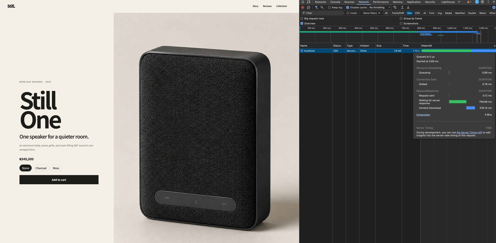

# Streaming Server Rendering

This experiment keeps the product, review, and recommendation reads parallel while allowing each ready section to reach the browser independently. The goal is to improve visual progress without making the simulated data sources faster.

## Result

| Rendering strategy | Waiting for server response | Content download | Delivery behavior |
| --- | ---: | ---: | --- |
| Server `Promise.all` | 1.15 s | 1.09 ms | Wait, then send the completed page |
| Streaming SSR | 748.68 ms | 376.14 ms | Send the product shell, then stream delayed sections |

These values come from local development captures with a desktop viewport, disabled cache, and no network throttling. Development timing is useful for explaining the response shape, not as a production benchmark.



The total request duration remains close to 1.1 seconds in both cases. Streaming changes when useful HTML becomes available: the product content can arrive roughly 400 ms before the final recommendation data.

## From One Barrier to Independent Boundaries

The previous experiment used one barrier around every read:

```tsx
const [product, reviews, relatedProducts] = await Promise.all([
  getProduct(),
  getReviews(),
  getRelatedProducts(),
]);
```

This removes the data waterfall, but rendering still waits for the slowest operation. The streaming version starts the same operations immediately and waits only for the product before returning the page shell:

```tsx
const productPromise = getProduct();
const reviewsPromise = getReviews();
const relatedProductsPromise = getRelatedProducts();

const product = await productPromise;
```

Reviews and recommendations receive the already-running promises behind separate Suspense boundaries:

```tsx
<Suspense fallback={<ProductReviewsFallback />}>
  <ProductReviews reviewsPromise={reviewsPromise} />
</Suspense>

<Suspense fallback={<RelatedProductsFallback />}>
  <RelatedProducts productsPromise={relatedProductsPromise} />
</Suspense>
```

The expected server timeline is:

```text
0 ms      start product, reviews, and recommendations
700 ms    product resolves; send the shell and both fallbacks
900 ms    reviews resolve; stream the review section
1100 ms   recommendations resolve; stream the collection section
```

The browser does not make separate review or recommendation fetches after hydration. Their HTML is part of the streamed document response.

## Choosing the Shell

The product details remain outside Suspense because they identify the page and provide the primary above-the-fold content. Reviews and recommendations are independent, below-the-fold sections that can appear later without making the page difficult to understand.

This is a design choice, not a rule that initial content must never use Suspense. React recommends making the shell feel minimal but complete. If the product read were significantly slower, a representative product skeleton could become part of the shell while `ProductDetails` moved behind its own Suspense boundary.

The trade-off would be an earlier shell against a later product LCP, additional fallback design, and possible layout movement. Critical data required for redirects, status codes, or layout decisions may also need to resolve before streaming starts.

## Fallbacks and Layout Stability

Each fallback repeats the final section heading and reserves a three-column content area. The collection placeholder also reserves space for the product copy below each image. This reduces movement when streamed HTML replaces the fallback.

Reserved space reduces CLS risk but does not prove that CLS is zero. The later layout experiment measures actual Layout Shift entries and adjusts the placeholders if necessary.

## What Streaming Does Not Do

- It does not reduce the 700 ms, 900 ms, or 1,100 ms simulated data delays.
- It does not make every section appear at the same time.
- It does not require client-side Effects to fetch server-rendered content.
- It does not replace caching. Stable product data should still be evaluated for prerendering or revalidation in a real application.

Streaming improves perceived performance by sending completed work sooner instead of holding it behind the slowest operation.

## Verification

```bash
corepack pnpm test:data
corepack pnpm test:streaming
corepack pnpm test:rendering
```

The data test verifies that every section finishes within the overall budget. The streaming test reads the document response as chunks and verifies that the primary product content arrives before the delayed review content. The rendering test verifies that the primary product remains available without client-side JavaScript.

## References

- [React: Specifying what goes into the shell](https://react.dev/reference/react-dom/server/renderToPipeableStream#specifying-what-goes-into-the-shell)
- [React: Suspense](https://react.dev/reference/react/Suspense)
- [Next.js: Fetching Data and Streaming](https://nextjs.org/docs/app/getting-started/fetching-data)
- [Next.js: Server and Client Components](https://nextjs.org/docs/app/getting-started/server-and-client-components)
