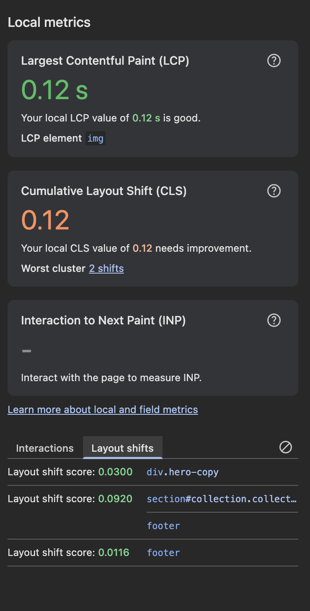
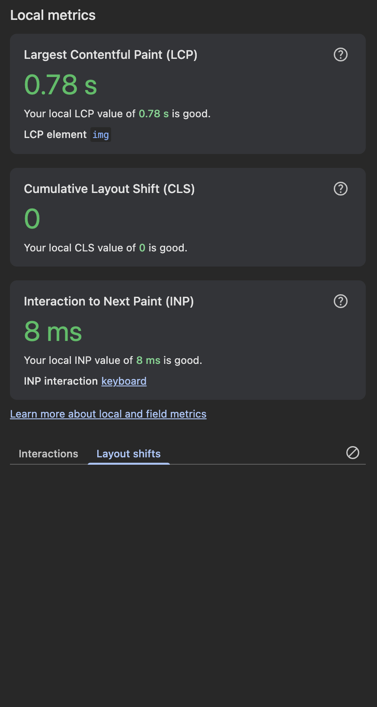

# Layout Stability Verification

The previous experiments changed when content appears and how much space media reserves. This verification checks their combined effect on Cumulative Layout Shift rather than introducing another implementation.

## Result

| Measurement | Baseline | Improved |
| --- | ---: | ---: |
| Local CLS | 0.12 | 0 |
| Reported layout shifts | 3 | 0 |

The baseline needed improvement, while the improved page recorded no layout shifts during this local run.

### Before



The baseline report identified these affected elements:

- `div.hero-copy`, with a displayed shift score of 0.0300;
- `section#collection` and `footer`, with a displayed shift score of 0.0920;
- `footer`, with a displayed shift score of 0.0116.

Product details and recommendations arrived after the initial render, so inserting them changed the height of existing sections and moved content that was already visible.

### After



No additional layout-specific code was required. The result came from earlier changes working together:

- server-rendered product details remove the late insertion in the hero copy;
- explicit image and video dimensions reserve media space;
- responsive image dimensions preserve the product cards' aspect ratio;
- `Suspense` fallbacks reserve space while reviews and recommendations stream.

## Measurement Method

Both pages were built and served in production mode:

```bash
corepack pnpm build
corepack pnpm start
```

Chrome DevTools Local Metrics recorded the CLS value and listed the elements affected by each layout shift. Production mode avoids development-only compilation, Fast Refresh, and debugging behavior that can distort rendering measurements.

## Interpretation

This comparison is useful evidence that the known layout shifts were removed, but it is still a local diagnostic rather than field data. CLS can vary with viewport size, content, device, cache state, and user behavior. A deployed page should still be monitored with real-user Web Vitals at the 75th percentile.

The LCP values shown in these screenshots are not compared. Localhost transfer speed, the lab's intentional server delay, and a cold image-optimization request can dominate a single local LCP run.

INP is also outside this verification. The page does not contain a representative interaction workload, so a synthetic interaction would not provide a meaningful product-performance result.
